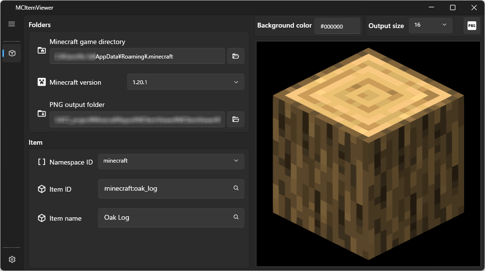
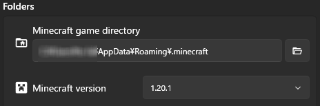
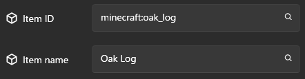

# MCItemViewer

✨ [日本語](../README.md)

A tool for viewing Minecraft items without launching Minecraft.

You can also export the displayed item as an image.

## 🌟 Features

- Displays the items available in the specified Minecraft version.
- Exports the displayed item as an image (PNG format).
- Japanese/English display language switching (Settings page). Item names also follow the selected language.

## 🖥️ System requirements

- Windows 10 64bit
- Windows 11 64bit

## ⭕ Supported Minecraft versions

Minecraft Java Edition 1.13 or later

## ☑️ Operation confirmed versions

- 1.13
- 1.20.1
- 1.21.3
- 1.21.4
- 1.21.5

## 🧩 Usage

1. Set the Minecraft game directory and version.

   

2. Enter an item ID or item name.

   *1 Suggestions are shown as you type.

   *2 In the current version, the namespace is fixed to `minecraft`.

   

3. The entered item is displayed on the right.

   *Even if you enter an item ID or item name, the actual item may not be displayed in some cases.

4. To export the displayed item as an image, select the output size (in pixels) and click the "Export PNG" button on the right.

   The image is saved to the location specified in "PNG output folder".

   

## 😔 Not supported (Will be supported in the future)

- Block entities such as chests and beds are not displayed.
- In 1.21.4 and later, biome colors may not be applied to items such as grass.
- Items added by MODs are not supported.
